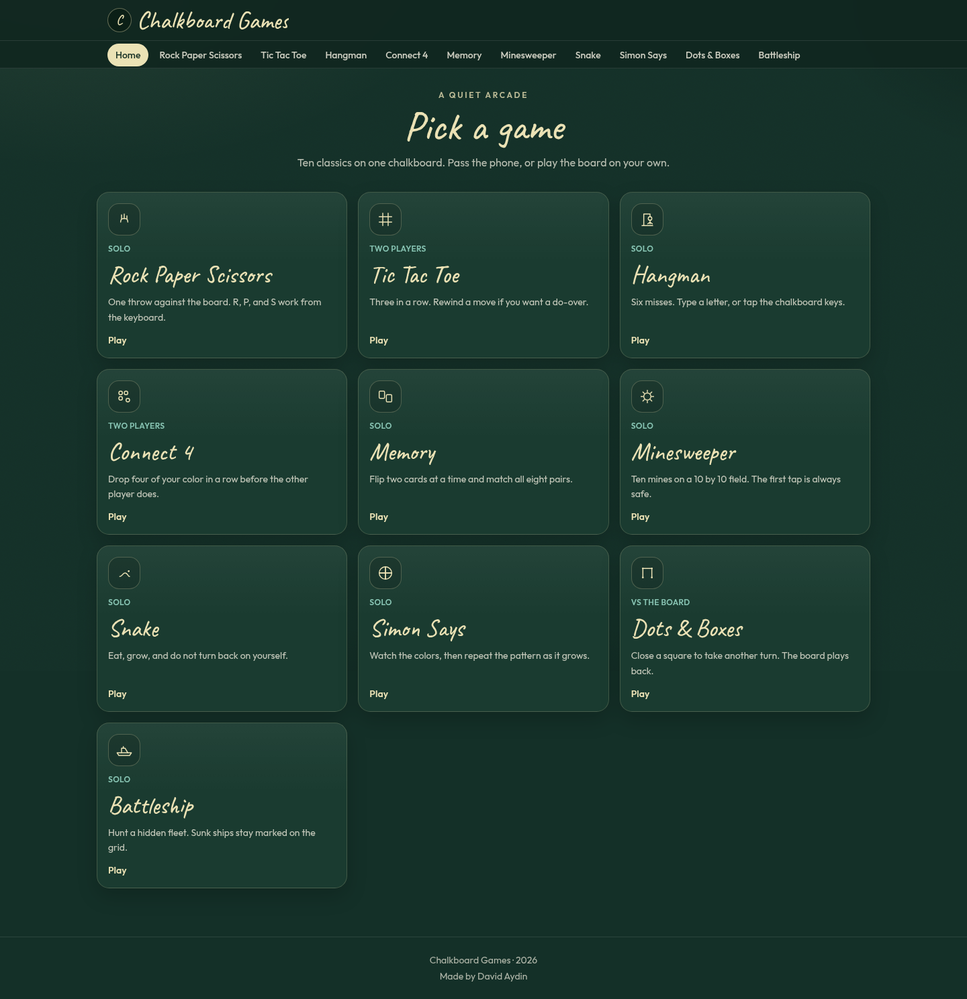
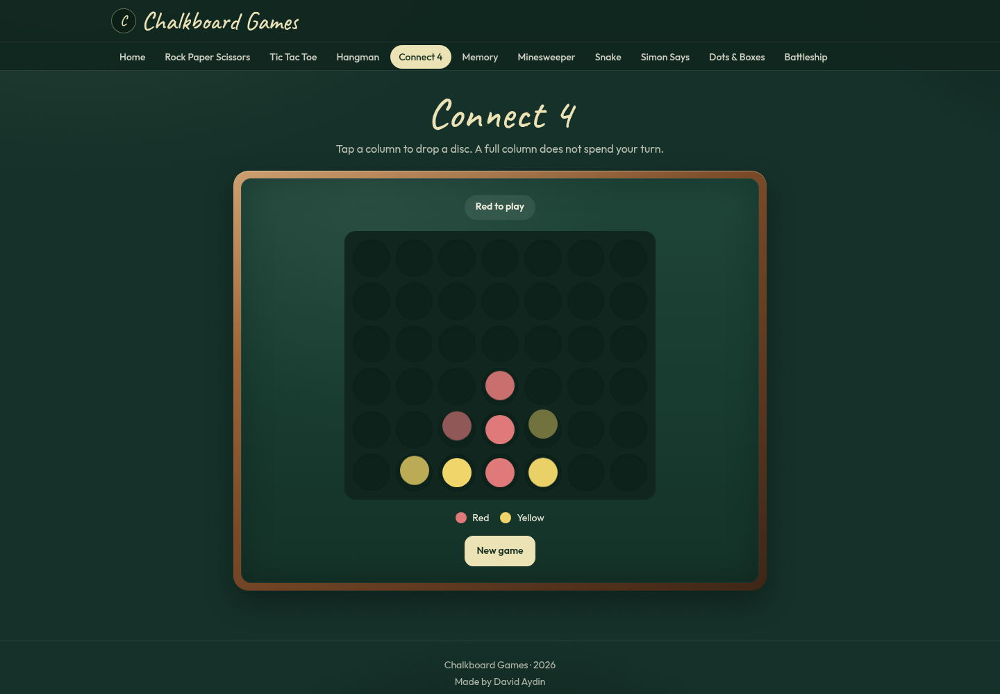
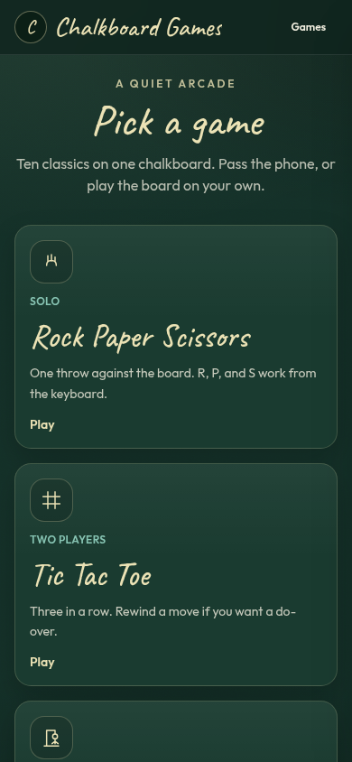
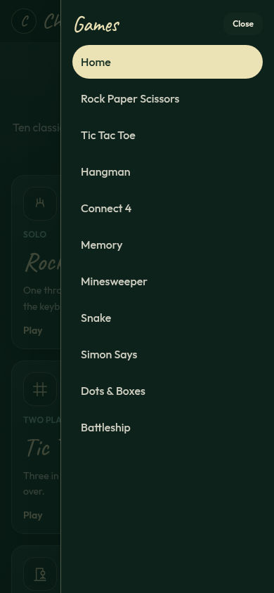
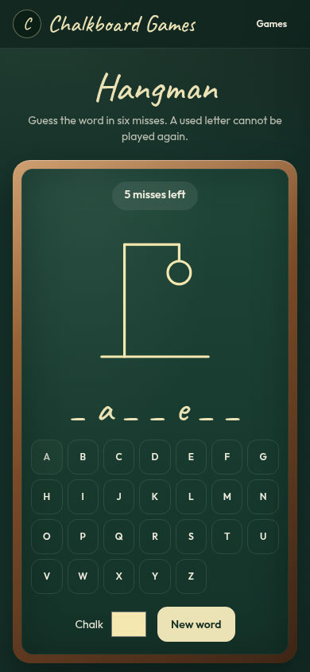
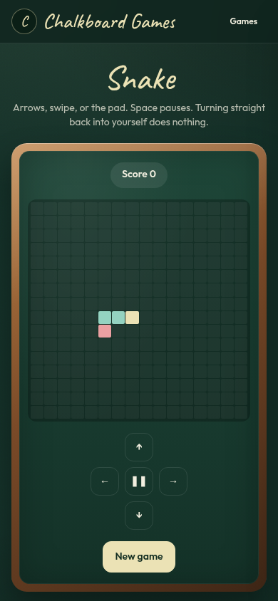

# Chalkboard Games


Classic games on a digital chalkboard, built by David Aydin.

Live site: https://daydin14.github.io/chalkboard-games/

## Games

- Rock Paper Scissors
- Tic Tac Toe, with move rewind
- Hangman
- Connect 4
- Memory
- Minesweeper
- Snake
- Simon Says
- Dots & Boxes
- Battleship

## Screenshots

### Desktop





### Mobile






## Getting started

The app lives in `app`. Node 20 or newer is required.

```bash
cd app
npm install
npm run dev
```

Vite serves the app at `http://localhost:5173/chalkboard-games/`. The `/chalkboard-games/` base path matches the GitHub Pages project site.

| Script | What it does |
| --- | --- |
| `npm run dev` | Start the dev server |
| `npm run lint` | ESLint |
| `npm test` | Game-rule tests |
| `npm run build` | Production build in `dist/` |
| `npm run preview` | Serve the production build |

## Stack

- React 19 and React Router
- Vite 7
- Tailwind CSS 4 and daisyUI 5, with a custom chalkboard theme
- Vitest for the game rules

## Deployment

Pushes to `master` run `.github/workflows/ci.yml`. The workflow lints, tests, and builds `app`, copies `index.html` to `404.html` so client-side routes survive a refresh, and deploys the `dist` folder to GitHub Pages.

The production base path is `/chalkboard-games/`.

**Pages source:** this repository currently publishes from the legacy `gh-pages` branch. The new workflow deploys only after the source is switched:

1. Open **Settings → Pages → Build and deployment**.
2. Set **Source** to **GitHub Actions**.

Until that setting changes, the Actions deploy job cannot update https://daydin14.github.io/chalkboard-games/. The old `gh-pages` branch is no longer the build output.
